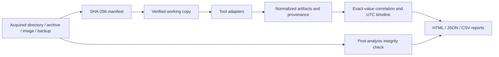

# Architecture and extension guide

The platform runs locally. The dashboard calls the same `analyze()` function used by the CLI, so analysis does not depend on an open browser tab.

## Modules

| Module | Responsibility |
|---|---|
| `evidence.py` | Evidence inventory, copying and verification, bounded ZIP/TAR extraction, link rejection |
| `runner.py` | Subprocess execution without a shell, timeout, cancellation, stdout/stderr capture, executable hashes |
| `adapters.py` | Tool applicability, commands, output parsing, source provenance |
| `worker.py` | SQLite and yara-python in separate, cancellable processes |
| `mvt_worker.py` | MVT with private case settings and networking disabled |
| `core.py` | Artifact schema, epoch/timezone normalization, entity extraction and exact-value correlations |
| `pipeline.py` | Case lifecycle, audit trail, evidence recheck, metrics and exports |
| `server.py` | Loopback dashboard API, session token, one active case at a time |
| `static/` and `report.py` | Dashboard and self-contained interactive HTML reports |

## Adapter contract

Subclass `Adapter`, implement `name`, `applicable(ctx)` (a reason to skip, or `None`), and `run(ctx)` returning artifact dictionaries created with `core.artifact()`. Call `ctx.run()` for each process so commands, logs, timeouts and cancellation are recorded. Register the adapter in `ADAPTERS` and `TOOL_NAMES`, add discovery in `config.py`, then add fixture and installed-tool tests. Trusted tool commands are configured as argument arrays, never shell command strings. They are local executable code and should be configured by the investigator.

Artifacts retain source, type, evidence/output path, original values, optional UTC timestamp with conversion basis, severity, entities, and row/line provenance. Stable IDs allow correlations and timeline rows to refer back to findings. Equal paths, URLs, domains and hashes create associations only when supported by at least two sources. These are leads, not a probability score or automatic verdict.

## Evidence and scale boundaries

Tools receive working copies, including SQLite WAL companions. The original manifest is compared again after analysis. This application does not replace hardware write blockers or validate acquisition methods. It cannot decrypt encrypted devices or acquire a physical phone. Unsupported encrypted archives fail explicitly.

SQLite rows are limited per table (default 1,000; 200 tables per database); text and BLOB previews are bounded. Each adapter normalizes up to 50,000 findings and leaves raw output on disk. Reaching a limit is marked partial. The browser displays up to 500 matching findings; JSON contains all normalized findings. This prototype keeps case results in memory and is intended for small and medium controlled evaluation datasets. It is not optimized for multi-terabyte cases. Original hashing/copying may take time; cancellation is applied at tool boundaries and while tools run, not midway through evidence copying.

## Local service

The server binds to `127.0.0.1`, checks the Host/Origin headers, and requires a random bearer token for the API. It is a single-investigator local application, not a multi-user or Internet-facing service. Evidence text is rendered using `textContent`; HTML report data escapes script delimiters. Rules, indicators, logs and reports stay inside the local case directory. MVT's network setting is disabled; the tested version is pinned in `requirements-forensics.txt`.
